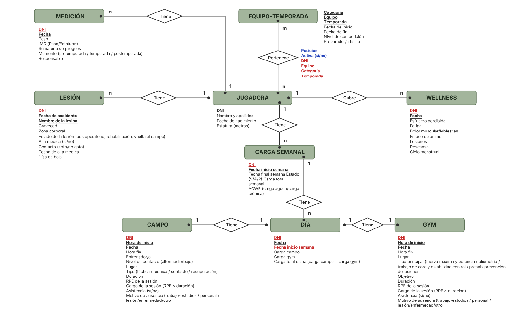

# Modelo entidad-relación

Transcripción del diagrama `modelo-entidad-relacion.png`.

Convención del diagrama: **subrayado** = forma parte de la clave primaria;
rojo = clave ajena (atributo que viene de otra entidad);
azul = atributo propio de una relación.

## Relaciones y cardinalidades

| Relación    | Entidad A        | Card. A | Card. B | Entidad B      | Tipo |
|-------------|------------------|:-------:|:-------:|----------------|------|
| Tiene       | JUGADORA         | 1       | n       | MEDICIÓN       | 1:N  |
| Tiene       | JUGADORA         | 1       | n       | LESIÓN         | 1:N  |
| Cubre       | JUGADORA         | 1       | n       | WELLNESS       | 1:N  |
| Tiene       | JUGADORA         | 1       | n       | CARGA SEMANAL  | 1:N  |
| Pertenece   | EQUIPO-TEMPORADA | m       | n       | JUGADORA       | N:M  |
| Tiene       | CARGA SEMANAL    | 1       | n       | DÍA            | 1:N  |
| Tiene       | DÍA              | 1       | 1       | CAMPO          | 1:1  |
| Tiene       | DÍA              | 1       | 1       | GYM            | 1:1  |

La relación **Pertenece** (N:M) tiene atributos propios: *Posición* y *Activa (sí/no)*,
y su clave está formada por las claves ajenas *DNI*, *Equipo*, *Categoría* y *Temporada*.

## Entidades

### JUGADORA
- **DNI** (PK)
- Nombre y apellidos
- Fecha de nacimiento
- Estatura (metros)

### EQUIPO-TEMPORADA
- **Categoría** (PK)
- **Equipo** (PK)
- **Temporada** (PK)
- Fecha de inicio
- Fecha de fin
- Nivel de competición
- Preparador/a físico

### MEDICIÓN
- **DNI** (PK, FK → JUGADORA)
- **Fecha** (PK)
- Peso
- IMC (Peso/Estatura²)
- Sumatorio de pliegues
- Momento (pretemporada / temporada / postemporada)
- Responsable

### LESIÓN
- **DNI** (PK, FK → JUGADORA)
- **Fecha de accidente** (PK)
- **Nombre de la lesión** (PK)
- Gravedad
- Zona corporal
- Estado de la lesión (postoperatorio, rehabilitación, vuelta al campo)
- Alta médica (sí/no)
- Contacto (apto/no apto)
- Fecha de alta médica
- Días de baja

### WELLNESS
- **DNI** (PK, FK → JUGADORA)
- **Fecha** (PK)
- Esfuerzo percibido
- Fatiga
- Dolor muscular/Molestias
- Estado de ánimo
- Lesiones
- Descanso
- Ciclo menstrual

### CARGA SEMANAL
- **DNI** (PK, FK → JUGADORA)
- **Fecha inicio semana** (PK)
- Fecha final semana
- Estado (V/A/R)
- Carga total semanal
- ACWR (carga aguda/carga crónica)

### DÍA
- **DNI** (PK, FK → JUGADORA)
- **Fecha** (PK)
- Fecha inicio semana (FK → CARGA SEMANAL)
- Carga campo
- Carga gym
- Carga total diaria (carga campo + carga gym)

### CAMPO
- **DNI** (PK, FK)
- **Hora de inicio** (PK)
- **Fecha** (PK)
- Hora fin
- Entrenador/a
- Nivel de contacto (alto/medio/bajo)
- Lugar
- Tipo (táctica / técnica / contacto / recuperación)
- Duración
- RPE de la sesión
- Carga de la sesión (RPE × duración)
- Asistencia (sí/no)
- Motivo de ausencia (trabajo-estudios / personal / lesión/enfermedad / otro)

### GYM
- **DNI** (PK, FK)
- **Hora de inicio** (PK)
- **Fecha** (PK)
- Hora fin
- Lugar
- Tipo principal (fuerza máxima y potencia / pliometría / trabajo de core y estabilidad central / prehab-prevención de lesiones)
- Objetivo
- Duración
- RPE de la sesión
- Carga de la sesión (RPE × duración)
- Asistencia (sí/no)
- Motivo de ausencia (trabajo-estudios / personal / lesión/enfermedad / otro)

## Puntos a revisar en el diagrama

- **DÍA–CAMPO y DÍA–GYM son 1:1**, pero la clave de CAMPO y GYM incluye *Hora de inicio*,
  lo que solo tiene sentido si puede haber **varias sesiones el mismo día**. O la
  cardinalidad debería ser 1:N (un día tiene n sesiones), o *Hora de inicio* sobra en la clave.
  Además, con 1:1 obligatorio no se podría registrar un día con solo campo o solo gym.
- **IMC** se calcula con *Estatura*, que está en JUGADORA y no en MEDICIÓN: si la estatura
  cambia, se pierde el histórico. Es un atributo derivado (podría calcularse, no guardarse).
- **Carga total diaria**, **Carga de la sesión**, **Carga total semanal** y **ACWR** también
  son derivados.
- WELLNESS tiene un atributo *Lesiones* que puede solaparse con la entidad LESIÓN.
